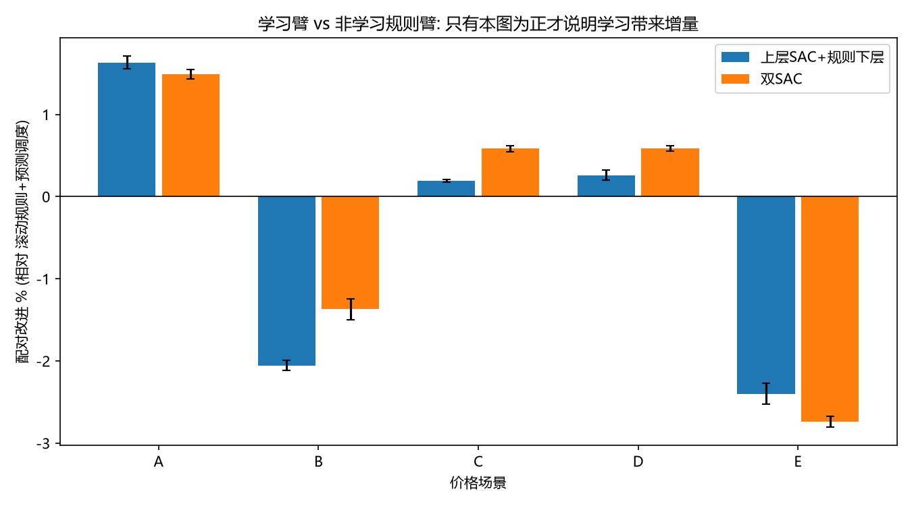
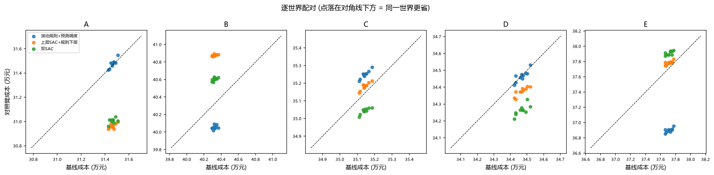
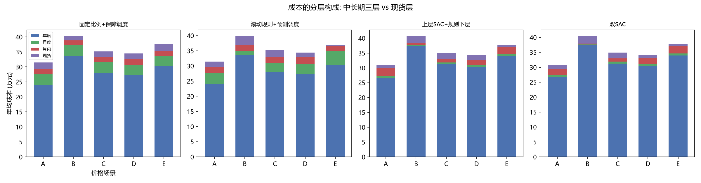
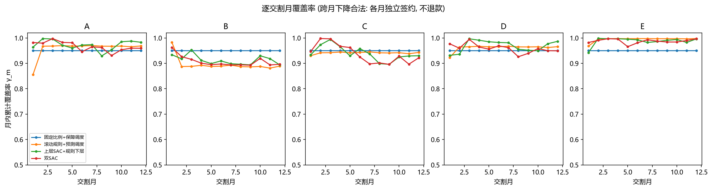

# 基于深度强化学习的多时间尺度电力交易策略研究

**课程设计报告**

> ## ⚠️ 结论撤回说明（2026-10-21）
>
> 外部复核发现：迭代 7 及之前的结算实现把**同一度电在"合同成本"与"现货成本"两个口径里重复计量**
> （约 3.25 倍，已在 `experiments/test_settlement_accounting.py` 中定量复现），因此本报告原先给出的
> **年成本绝对值与全部改进百分比已整体作废，并从正文、表格与图链中删除**，不能作为成果引用；
> 撤回的原始数值只能在 git 历史（提交 `f2b4f7c` 及之前）中查见。第 5 章改为只陈述
> 作废的理由与口径修正后的可复现实测，不再罗列任何旧口径数字。
>
> 迭代 8 完成了四类修复：① 逐交割月合同台账与偏差结算（会计）；② 设备执行闭环（EV SOC 时序积分、
> 工业日任务守恒，删除"调整后负荷重新归一化"）；③ 信息边界（发布游标，观察不含未来实现值）；
> ④ 双智能体按角色决策时序（半 MDP，跨步折扣 γ^Δt）与模型重载一致。配套 58 个验收用例全部通过，
> 并建立四臂配对世界基准（固定比例＋保障调度 / 滚动规则＋预测调度 / 上层 SAC＋规则下层 / 双 SAC）。
>
> **当前可主张**：建模与实现自洽、账目可手算、物理闭环可复算、实验框架公平（含非学习强基线）；
> 以及 5.4 节按修正口径跑完的四臂配对基准结论——在本文冻结预算下，**双 DRL 平均并不优于只用公开信息、
> 零训练成本的滚动规则基线**（5 场景均值 −0.09%，`sac_rule` −0.45%），学习臂的改进符号完全由
> "年度层是否比月度层便宜"决定，机制定位见 5.4.1。
> **当前不可主张**：任何"端到端学到的仓位策略稳定降本"的正向结论；旧口径的两位数降本已全部作废并从正文删除。
>
> 最低验收门槛（已逐项通过）：**无虚假退款、电量守恒、设备按时完成、费用可手算、
> 观察不含未来实现值、模型重载一致。**

---

## 摘要

在电力市场化改革不断深入的背景下，售电公司和大用户需要在年度、月度、月内（日前）与现货等多个时间尺度市场上协同决策购电仓位，并利用电动汽车（EV）集群与工业可转移负荷等柔性资源参与需求响应，以实现购电成本的最小化。该问题具有**多时间尺度耦合、序贯决策、动态环境**三大特征，传统优化方法难以同时刻画"当前决策影响未来状态"的时序依赖关系。

本文将上述问题建模为**多时间尺度马尔可夫决策过程（MDP）**，提出一种**双深度强化学习（DRL）智能体**协同框架：中长期智能体（SAC）决策年度/月度/月内三级合同的**逐交割月覆盖率** $\alpha/\beta_m/\gamma_m$，柔性调度智能体（SAC）决策当月**柔性调度强度**（它只决定"多大程度择优用电/放电"，不决定现货采购电量——现货侧只结算合同量与实际净需求之差），二者通过仓位约束与信息衔接相互耦合，严格满足任务书"针对不同交易时间尺度构建相互衔接的深度强化学习智能体"的要求。

针对多智能体强化学习在该场景下的**信用分配（credit assignment）难题**——中长期决策主导绝大部分成本、现货柔性调节只影响较小的边际成本——本文提出**未来暴露成本塑形（future-exposure reward shaping）**机制：在中长期智能体的月内决策步，将其 $\gamma_m$ 决策所引致的现货敞口成本显式计入即时奖励，使智能体"感知"少锁仓→高现货暴露→未来高成本的因果链。迭代 7 曾据当时的消融把方案简化，**该消融结论测量于作废的结算口径之上，已撤回**；本文在修正口径与四臂入口开关上重做了同一测量（5.9 节）：**暴露成本塑形是唯一通过判读门槛的部件**（关闭后两条学习臂分别贵 1.70% 与 1.40%，30/30 个配对世界更贵、3/3 种子同号），而现货奖励放大与三阶段交替训练的配对差只有 +0.26%/+0.07% 与 +0.05%，低于 0.4% 的运行间噪声门槛且逐种子符号不一致。现行主基准配置为三部件全开，本文不再使用"据此简化方案"的说法。

本文完成了从市场建模、柔性负荷物理执行、双 DRL 智能体到四臂配对世界基准的**全链路实现与可复算验证**（58 个验收用例覆盖"无虚假退款、电量守恒、设备按时完成、费用可手算、观察不含未来实现值、模型重载一致"）。实验方面，按冻结预算跑完了 5 价格场景 × 4 臂 × 3 种子 × 2000 回合的配对世界基准（600 个评估世界全部通过会计与物理验收），并以一次同配置重复运行测得的运行间噪声（0.09%~0.37%）设定**判读门槛**：改进需明显大于 0.4% 且在 3 个种子 × 10 个配对世界上方向一致才作为证据。**实测结果是负面的**：只用公开信息、零训练成本的滚动规则基线平均降本 +0.69%，双 DRL 为 +0.61%（相对滚动规则 −0.09%），"双 DRL 优于规则策略"在本文预算下不成立。本文不掩饰这一结果，而是把它定位到可检验的机制上：两条学习臂的年度签约在所有场景中都饱和在动作上限（$\alpha\approx0.89$），导致其改进符号与"年度层均价是否低于月度层"完全一致——年度便宜时（A/C/D）相对强基线为 +0.18%~+1.85%，年度昂贵时（B/E）反而更贵 1.41%~2.38%；而年度决策时点观察里月度/月内价尚未公布，正是这一失效的信息论解释。相形之下，柔性调度臂在现货层有一致的正向表现（`dual_sac` 的现货成交均价在 5 个场景全部低于两条规则臂；单独剥离第二个智能体的配对增量为 +0.37%，B/C/D 场景逐世界 30/30 全胜），说明学习确实在做功能的地方做功。

**关键词**：深度强化学习；软演员-评论家（SAC）；多时间尺度电力交易；柔性负荷；信用分配；奖励塑形；CVaR

---

## 第 1 章 引言

### 1.1 研究背景与意义

随着电力体制改革推进，我国逐步建立起"中长期交易 + 现货交易"相互衔接的多层次电力市场体系。售电公司与大工业用户面临的核心经营问题是：**如何在时间跨度、价格机制、风险特征各不相同的多级市场中安排购电组合，并借助需求侧柔性资源优化用能曲线，最终实现总购电成本最小化。**

- **多时间尺度**：年度双边协商、月度集中竞价、月内（日前）滚动、现货（日内/实时）市场在提前期、流动性和价格水平上差异显著。年度合同通常价格较低但锁定量大、灵活性差；现货市场价格波动剧烈、存在尖峰风险，但提供了低负荷时段的机会。
- **序贯性与耦合性**：前期锁定的仓位约束了后期的可选决策空间（0 ≤ α ≤ β ≤ γ ≤ 1），当前月的现货暴露由累计中长期仓位决定，决策之间存在跨期耦合。
- **柔性资源协同**：EV 集群充放电与工业可转移负荷可在时间上平移用电，是平抑现货尖峰、降低暴露成本的重要抓手。

传统随机规划/鲁棒优化方法虽能处理不确定性，但需要对价格分布做较强假设，且在高维状态空间中求解代价大、难以刻画长时序依赖。深度强化学习（DRL）能够通过与环境交互端到端地学习序贯策略，天然适合此类多阶段动态决策问题，因此本文采用 DRL 求解多时间尺度电力交易策略。

### 1.2 国内外研究现状

**（1）电力市场交易决策优化。** 早期研究以混合整数规划、随机规划刻画中长期合约组合，通过场景生成与削减处理价格不确定性；近年来鲁棒优化、条件风险价值（CVaR）被广泛用于控制现货暴露带来的尾部风险。此类方法的共同局限在于：最优策略高度依赖对未来价格分布的准确假设，且模型规模随时间尺度与决策维度迅速膨胀。

**（2）DRL 在能源交易中的应用。** 深度 Q 网络（DQN）、近端策略优化（PPO）、软演员-评论家（SAC）等算法已被用于电池储能套利、需求响应调度、电力竞价等任务。相较 DQN 仅适用于离散动作，SAC 在连续动作空间中兼具最大熵探索、样本效率与训练稳定性，适合输出连续的交易比例与柔性调节量。

**（3）多智能体与分层强化学习。** 当决策涉及多个耦合主体时，多智能体强化学习（MARL）与分层强化学习（HRL）是主流范式。然而 MARL 面临**非平稳性**与**信用分配**两大挑战：当不同子决策对全局回报的贡献量级悬殊时，弱贡献智能体难以从噪声中学习。本文的核心技术贡献正是针对电力交易场景中"中长期合同主导成本、柔性调度只影响边际成本"这一具体挑战，提出简洁有效的奖励塑形解决方案。

### 1.3 本文主要工作

1. **多时间尺度市场与柔性负荷建模**：构建年度/月度/月内/现货四级市场的 Gym 环境，按**交割月**记账（参考交付电量 $R_m$、合同台账、偏差结算），并集成 EV 集群与工业可转移负荷的物理执行模型（SOC 时序积分、日任务守恒）。
2. **双 DRL 智能体协同框架**：设计中长期 SAC 智能体与柔性调度 SAC 智能体，通过动作解耦、独立经验池、按各自决策时序衔接的半 MDP 训练与仓位约束实现"相互衔接"，严格满足任务书要求。
3. **信用分配解决方案**：提出未来暴露成本塑形机制，并在修正会计口径与四臂入口开关上重做消融（5.9 节），量化三个设计部件各自的贡献——暴露成本塑形是唯一超过判读门槛的部件（关闭后贵 1.40%~1.70%，30/30 世界、3/3 种子同号），现货奖励放大与三阶段交替训练在场景 A 检不出。
4. **可复算的验证体系与四臂基准**：58 个验收用例覆盖"无虚假退款、电量守恒、设备按时完成、费用可手算、观察不含未来实现值、模型重载一致"；建立固定比例／滚动规则／上层 SAC＋规则下层／双 SAC 四臂**配对世界**基准（同世界、同设备任务、冻结预算与种子），使任何 DRL 增益必须在够强的非学习基线前接受检验。

### 1.4 报告组织结构

第 2 章建立多时间尺度电力交易市场模型；第 3 章建立柔性负荷模型；第 4 章详述双 DRL 智能体方法与信用分配机制；第 5 章给出实验设置、结果与分析；第 6 章总结全文并展望未来工作。

---

## 第 2 章 多时间尺度电力交易市场建模

### 2.1 四级市场与逐交割月覆盖率模型

设用户在一个决策周期（本文取一年，划分为 12 个月）内的总需求电量为 $Q$（本文取 $Q=1000$ MWh，作为归一化基准），第 $m$ 个交割月的**参考交付电量**为 $R_m$，满足

$$
\sum_{m=1}^{12} R_m = Q \qquad (\text{默认均匀 } R_m = Q/12)
$$

电力交易在四个时间尺度市场依次进行：

| 市场 | 提前期 | 符号 | 含义 |
|------|--------|------|------|
| 年度市场 | 年 | $\alpha$ | 年度合同对**每个交割月**的覆盖率（全年一次签约） |
| 月度市场 | 月 | $\beta_m$ | 第 $m$ 月在年度合同之上的累计覆盖率 |
| 月内市场 | 日/时段 | $\gamma_m$ | 第 $m$ 月中长期累计覆盖率 |
| 现货市场 | 实时 | — | 只结算合同量与实际净需求之差 $A_m-\gamma_m R_m$ |

每批合同的成交电量**按交割月**记账，增量形式保证全年合同电量恒等于 $Q$：

$$
Q^{\text{Y}}_m = \alpha R_m,\quad
Q^{\text{M}}_m = (\beta_m-\alpha) R_m,\quad
Q^{\text{I}}_m = (\gamma_m-\beta_m) R_m,\quad
Q^{\text{S}}_m = A_m-\gamma_m R_m
$$

其中 $A_m$ 是柔性设备**实际执行后**第 $m$ 月的网侧净需求（不执行调度时 $A_m=R_m$）。
仓位需满足同月层内单调性：

$$
0 \le \alpha \le \beta_m \le \gamma_m \le 1,\qquad m=1,\dots,12
$$

该约束是"多时间尺度衔接"的数学体现：年度决策决定该月月度决策的下界，月度决定月内的下界，
而 $\gamma_m$ 决定该月的现货暴露。注意单调性只在**同一交割月内**成立——不同月份的覆盖率可以更低，
因为那是对不同交割月的独立签约，不构成对上月合同的撤销。

### 2.2 结算模型与合同台账

结算引擎 `SettlementEngine` 按**交割月**记账，每一批合同都是一条可手算复核的台账记录
（`contract_id / stage / signed_step / deliver_month / quantity / price / cost`）：

- **年度**：$m=1..12$ 各记 $\text{cost}^{\text{Y}}_m = p_{\text{annual}}\cdot \alpha R_m$，全年只成交一次。
- **月度**（第 $m$ 月）：$\text{cost}^{\text{M}}_m = p^{\text{monthly}}_m\cdot(\beta_m-\alpha)R_m$。
- **月内**（第 $m$ 月）：$\text{cost}^{\text{I}}_m = p^{\text{intraday}}_m\cdot(\gamma_m-\beta_m)R_m$。
- **现货（偏差）**：设该月设备执行后的逐时段网侧电量为 $q^{\text{need}}_{h}$（**该月真实电量**：
  仿真只走代表日的 24 时段，执行层结果统一乘 $K=\text{days\_per\_month}\times\text{demand\_scale}=16.0051$
  后才进入结算，与 $R_m$ 同尺度），$A_m=\sum_h q^{\text{need}}_{h}$，
  把月总偏差按逐时段用量比例分摊（不做任何重归一化）：
  $$
  \Delta E_h = q^{\text{need}}_{h}\Big(1-\frac{\gamma_m R_m}{A_m}\Big),\qquad
  \text{cost}^{\text{S}}_m=\sum_h p^{\text{spot}}_{m,h}\max(\Delta E_h,0)
  +(1-d)\sum_h p^{\text{spot}}_{m,h}\min(\Delta E_h,0)
  $$
  即**缺口（$\Delta E_h>0$）按该时段现货价 1:1 买入**（现货是残余市场，不再叠加惩罚项），
  **过购（$\Delta E_h<0$）按现货价 $\times(1-d)$ 回售**（$d=\text{sell\_discount}=0.20$ 代表批零价差，
  是全文唯一显式的不对称结算参数）。

年总成本 = 四级市场成本之和 + 工业负荷转移惩罚。

> **建模说明（合同不可撤销，负增量不是"退款"）**：开发过程中曾采用"跨月累计比例 + 允许负增量"的语义，
> 并声称"强制增量非负会导致成本模型膨胀约 4 倍，因此必须允许负增量"。**该说法已撤回**：
> 成本膨胀是因为旧口径同时把合同量与全额现货量计入成本（同一度电重复计量约 3.25 倍），
> 而不是负增量语义本身必要；任务书也明确不允许推翻已签合同。
> 最终方案改为**逐交割月覆盖率**：单调性 $\alpha\le\beta_m\le\gamma_m$ 由断言保证（不是把负增量裁成 0），
> 跨月覆盖率可以下降但不冲销上月合同；富余电量只能通过现货侧回售变现，并承受折价。
> 这样，"合同不可撤销"与"电量守恒"同时成立，成本口径可用台账逐批手算复核
> （`experiments/test_settlement_accounting.py`、`test_environment_accounting.py`）。

### 2.3 价格场景生成

为覆盖典型市场形态，构造 5 类价格场景（价格单位：元/MWh，参考我国电力现货市场水平）。月度、月内价格在基准附近叠加小幅高斯扰动；现货价格按 24 时段生成，高峰时段（9–12、18–21 时）价格上浮、低谷时段（0–6 时）下调，并叠加场景标准差以刻画尖峰风险。

| 场景 | 年度 | 月度 | 月内 | 现货均值 | 现货标准差 | 预期合理策略 |
|------|------|------|------|----------|------------|--------------|
| A 年度低价后期上涨 | 300 | 350 | 380 | 420 | 50 | 倾向提高 α（多锁年度低价） |
| B 年度高价后期下降 | 420 | 360 | 330 | 300 | 40 | 倾向降低 α（少锁高价、多暴露低价现货） |
| C 各阶段价格接近 | 350 | 355 | 360 | 365 | 30 | 价格差异小，风险约束主导配置 |
| D 现货高波动 | 340 | 350 | 360 | 400 | 120 | 倾向提高 γ（降低现货暴露以避险） |
| E 月度低价现货极端风险 | 380 | 310 | 350 | 500 | 200 | 在月度低价机会与现货尖峰风险间权衡 |

场景由 `PriceScenarioGenerator` 以固定随机种子生成，保证实验可复现。

---

## 第 3 章 柔性负荷建模

柔性资源是现货阶段降低暴露成本的关键。本文集成两类典型资源：电动汽车集群（可充可放，V2G）与工业可转移负荷（负荷时移）。关键在于：柔性动作不只是给出功率包络，而是**真正推进设备物理状态**，再取执行后的网侧净负荷进入市场结算。执行层为 `src/load/flexible_executor.py`。

### 3.1 电动汽车集群模型

`EVLoadModel` + `FlexibleExecutor` 以集群聚合方式刻画 EV 的充放电能力，主要参数：

| 参数 | 取值 | 说明 |
|------|------|------|
| 车辆数 | 50（默认） | 集群规模 |
| 单车电池容量 | 60 kWh | — |
| 充电功率 | 7 kW | 上限 |
| 放电功率 | 3 kW | 上限 |
| SOC 范围 | [0.2, 0.9] | 目标 0.8，到达初始 0.3 |
| 充电/放电效率 | 0.90 / 0.88 | 网侧↔电池，往返损耗约 12.4% |
| 到达/离开时刻 | 18 时 / 8 时 | 按在站车辆比例折算可用功率 |

执行层按小时**积分 SOC**（而非只检查包络），并施加如下硬约束：

- 离站前必须充回目标 SOC：$soc_{\text{depart}}\ge$ target；
- V2G 放电量同时受"当前可放电量"与"离站前还能充回多少"双重限制（闭式上限），并计入往返损耗；
- 同一小时不同时充电又放电；网侧净负荷逐小时不为负。

因此**"设备按时完成"是构造性保证，不是靠奖励惩罚换来的优化结果**——这也是验收用例的写法。

### 3.2 工业可转移负荷模型

`IndustrialLoadModel` + `FlexibleExecutor` 刻画可在时间上平移的工业负荷，主要参数：

| 参数 | 取值 | 说明 |
|------|------|------|
| 总功率 | 200 kW | 默认场景 |
| 可转移比例 | 0.3 | 可平移部分 |
| 转移窗口 | 4 h | 负荷可移动的时域跨度 |
| 转移惩罚成本 | 50 元/MWh | 产能损失的等效成本 |
| 最低生产负荷率 | 0.6 | 刚性部分，不可移动 |

每小时负荷拆为**刚性部分 + 可转移部分**：可转移部分只改变时刻分布，**日任务电量严格守恒**；
增载落点必须在转移窗口内且不超过可转移功率上限；若某次调整会使任务超窗不可行，则
commit-or-rollback 直接回退整笔调整。转移惩罚按实际迁移电量计入总成本；因为仿真每个交割月只走**代表日**
的 24 个时段，迁移电量必须先换成"本月真实电量"才能与第 2.2 节的 $q^{\text{need}}_h$（已同尺度换算）相加：
$\text{惩罚}_m = 50\ \text{元/MWh}\times(\text{代表日迁移量}\times \text{days\_per\_month}\times \text{demand\_scale})$，
用的就是市场电量同一个月度尺度因子 $K=\text{days\_per\_month}\times\text{demand\_scale}=16.0051$
（迭代 8.11 前此处漏乘 $K$，惩罚被低估约 16 倍）。

### 3.3 从动作到真实网侧电量

执行顺序严格为：**合法观察 → 智能体动作 → 设备实际执行 → 真实网侧电量 → 市场结算**。
柔性强度 $u_m\in[-1,1]$ 只决定"多大程度择优"（正号增载/充电、负号减载/放电），
逐时段落点由执行层按**已公布的日前价格**与上述物理约束决定。

**本模型的四条边界（避免把机制读成它没有的东西）**：

1. **月典型日批量调度，不是小时级主动现货交易**。每个交割月柔性层只输出**一个**强度标量，
   执行层在**代表日**的 24 个时段上按已公布的日前价排序落点，再乘 $K$ 放大到整月；
   它不会逐小时提交购电申报。
2. **现货电量是自动残余，不是决策变量**。进入现货的是"该月实际净需求 $A_m$ 减合同量 $\gamma_m R_m$"
   的差额（2.2 节），智能体只通过 $\gamma_m$ 与 $u_m$ **间接**改变暴露规模与结构。
3. **合同按事后负荷比例分摊，不是预锁小时曲线**。月总偏差按逐时段实际用量比例摊到各小时，
   不做任何重归一化；因此不存在"某小时的合同必须在该小时交割"的假设。
4. **"一年"是 12 个代表月 × 30 个代表日 = 360 天的归一化年度，不是自然年**。
   每月只走一天的 24 时段，整月电量靠 $K=\text{days\_per\_month}\times\text{demand\_scale}=16.0051$
   放大（其中 `days_per_month=30`、`demand_scale=0.5335` 是把中性剖面标定到 $\sum_m R_m=Q=1000$ MWh
   的一次性系数，见 3.3 末段），因此本文的绝对成本对应"1000 MWh 的归一化年度"，
   **不能按 365 天、8760 小时的真实用电量去读**；跨月天数差、节假日效应与检修停役在此表示下不存在。

这四条是显式的教学简化，与任务书"多时间尺度相互衔接"的目标不冲突；小时级主动报价与逐时曲线交割
属于另一类问题（需要订单簿与成交概率模型），本文不作主张，也不与本文结果比较。

需求形状完全由执行层给出，**不再对调整后的负荷做重新归一化**：物理量级只在"中性剖面"
（强度恒为 0，即保障调度）上一次性标定，使 $\sum_m R_m = Q$；标定系数在动作之后不再改变。
由此产生的缺口与富余如何处理，全部写成显式结算规则（见 2.2 节），不隐含在任何数组缩放里。

### 3.4 负荷场景组合

`LoadScenarioBuilder` 将 EV 与工业负荷组合为 5 种柔性充裕度场景，用于考察柔性规模对策略与收益的影响：

| 负荷场景 | EV 数量 | EV 充电功率 | 工业总功率 | 可转移比例 |
|----------|---------|-------------|------------|------------|
| 柔性充裕 | 100 | 10 kW | 200 kW | 0.5 |
| 柔性适中 | 50 | 7 kW | 200 kW | 0.3 |
| 柔性受限 | 20 | 7 kW | 200 kW | 0.15 |
| 纯刚性 | 0 | — | 200 kW | 0.0 |
| 柔性大规模 | 300 | 7 kW | 600 kW | 0.5 |

在双 DRL 方案中，柔性调度强度由**柔性调度智能体**给出；作为对照，分层臂与规则臂使用
`src/agent/rule_policies.py` 中的预测调度规则（滚动比价 + 价差强度），
其放电触发门槛取物理量而非人为超参：$\text{门槛}=\text{往返损耗}+\text{过购折卖折价}\approx0.46$。
旧的"基于价格百分位的固定削峰填谷"`FlexibleDispatcher` 只保留在历史脚本里，已不用于正式对比。

---

## 第 4 章 双 DRL 智能体方法与信用分配

### 4.1 问题建模为多时间尺度 MDP

将一年交易过程建模为 MDP $\langle S, A, P, R, \gamma\rangle$。一个 episode 内，环境按"年度 →（月度 → 月内 → 现货）× 12"的顺序推进，共 37 个决策步（1 步年度 + 12×3 步月度/月内/现货）。

**状态空间（13 维，全部取自发布游标内的已公开信息）**：

$$
s = [\underbrace{\alpha,\beta,\gamma}_{\text{仓位}},\ \underbrace{p_a,p_m,p_i}_{\text{已公布报价}},\ \underbrace{\bar p_s,\sigma_s}_{\text{现货水平/日内波幅}},\ \underbrace{\sin t,\cos t}_{\text{时间}},\ \underbrace{1-\gamma}_{\text{暴露}},\ \underbrace{c_{ev},c_{ind}}_{\text{可调容量}}]
$$

价格类特征按 /1000 归一化，容量按 $Q$ 归一化。**信息边界**是建模的一部分：

- 年度报价在签约时点公布；某月的月度/月内报价从该月对应决策时点起可见（价格槽位语义 =
  "该市场最近一次已公布的报价"，0 表示尚未开市）；
- 某月的**日前现货剖面只在该月现货决策时点可见**，交割后才进入公开历史；
- 中长期阶段的 $\bar p_s,\sigma_s$ 使用**已交割月份日前价的滚动统计**（首月无历史时退回公开年度
  合同价、波幅取 0），不再暴露"本月现货实现均值/标准差"；
- 生成器的隐含分布参数（如场景现货均价）已从奖励中删除，因为它不属于可观察信息。

验收：`experiments/test_information_boundary.py`——篡改未来 11 个月实现价格后，首月 4 个决策的
观察与奖励逐位不变；把生成器隐参污染成 $10^6$ 亦不改变结果。

**动作空间（2 维）**：$a=[a_{\text{ratio}},\,a_{\text{flex}}]$。$a_{\text{ratio}}$ 由中长期智能体在中长期阶段输出，经
$\text{target}=\text{lo}+\sigma(a_{\text{ratio}})\cdot(\text{hi}-\text{lo})$ 映射为该层目标覆盖率
（hi 取年度 0.90 / 月内 1.00，lo 为已有下界）；$a_{\text{flex}}\in[-1,1]$ 由柔性调度智能体在现货阶段输出，
决定调度方向与强度。每步仅由"当前阶段所属"的智能体输出有效动作，另一维填 0，实现**动作解耦**。

**动作可达集单一来源（迭代 8.11 加）**：$a_{\text{ratio}}$ 的裁剪上限与 $a_{\text{flex}}$ 的幅度上限都只写在
`src/utils/config.py` 的 `ACTION_BOUNDS`（`ratio_raw_limit=5.0`、`intensity_limit=1.0`）一处，
环境 `action_space` 的 `Box`、SAC 输出的 $\tanh$ 缩放、规则臂到动作的 `raw_for_coverage` 映射三处共用它。
在此之前规则臂可以给出超出 SAC $\tanh$ 可达范围的原始比例，"学习臂 vs 规则臂"的对比里就混进了
"可达集不同"这一混杂因素。现在环境对每个越界动作计数并写进逐世界验收 `checks.action_oob`，
600 个评估世界必须为 0（负控制：把越界动作强行喂给环境，该项立刻变红且成本不变——越界只表示
"这一步被裁剪"，不改变会计）。

### 4.2 SAC 算法

软演员-评论家（SAC）是面向连续动作空间的最大熵离策强化学习算法，同时优化策略 $\pi$ 与双 Q 价值函数，其目标含熵正则项以鼓励探索、提升鲁棒性。本文 SAC 实现要点：

- **Actor（GaussianPolicy）**：2 层全连接（隐藏维 256，ReLU），输出高斯分布的均值与对数标准差，经 $\tanh$ 压缩至 $[-1,1]$ 并做 Jacobian 修正得到对数概率；重参数化技巧采样。
- **Critic（QNetwork，Twin）**：双 Q 网络取较小值以抑制过估计。
- **自动温度调节**：$\alpha_{\text{temp}}$ 自适应，目标熵 $=-\dim(A)$。保存/加载时用 `log_alpha.copy_()` **原地**写入，保证温度优化器的参数绑定不失效（否则重载后 $\alpha_{\text{temp}}$ 永远不被更新）。
- **软更新**：目标网络以 $\tau=0.005$ 平滑更新。
- **带折扣的经验回放**：每条经验额外存 TD 折扣 $\gamma^{\Delta t}$，目标为
  $y=r+(1-\text{done})\,\gamma^{\Delta t}\,Q'$。这是因为两个智能体各自相邻决策之间隔着数步
  （见 4.3），用固定一步折扣会系统性错估跨期成本。
- **检查点指纹**：`save()` 记录状态/动作维度与网络形状及 `action_scale / target_entropy / gamma / tau`，`load()` 发现不一致直接抛错，避免"用错配置继续训练"这类静默失真。

超参数见附录 B（Actor/Critic/温度学习率均为 $3\times10^{-4}$，折扣因子 0.99，批大小 256，经验池容量 $10^6$，初始温度 0.2）。

### 4.3 双智能体架构与决策时序

本文以 `MultiScaleCoordinator` 协调两个独立的 SAC 智能体：

```
┌────────────────────────────────────────────────┐
│  中长期 SAC (action_scale=5.0)                  │
│  1D 动作: a_ratio → α / β_m / γ_m                │
│  负责阶段: annual / monthly / intraday (25 次)   │
│  独立经验池                                      │
└────────────────────┬───────────────────────────┘
                     │ γ_m 决定该月合同量 → 现货偏差基线
┌────────────────────▼───────────────────────────┐
│  柔性调度 SAC (action_scale=1.0)                │
│  1D 动作: a_flex ∈ [−1,1] → 当月调度强度         │
│  负责阶段: spot (12 次)                          │
│  独立经验池                                      │
└────────────────────────────────────────────────┘
```

**"相互衔接"的体现**：(1) 中长期智能体输出的 $\gamma_m$ 直接决定柔性调度智能体面对的偏差基线
$\gamma_m R_m$ 与现货阶段状态；(2) 两智能体共享同一环境状态但动作解耦、各用独立经验池，避免分布混合；
(3) 通过同月仓位约束 $\alpha\le\beta_m\le\gamma_m$ 保证跨尺度决策的时序一致性。
需要明确的是：**柔性调度智能体只决定"多大程度择优调度"，不决定现货采购电量**——
现货侧结算的是合同量与实际净需求之差，采购量由合同与真实需求共同决定，不由该智能体的动作直接给定。

**按角色的决策时序（半 MDP）**：每个智能体的 `next_state` 必须是**本角色自己的下一次决策**的观察，
而不是环境的下一步观察；跨过的步数 $\Delta t$ 折算成 TD 折扣 $\gamma^{\Delta t}$ 写入回放。
回合末尾两个角色仍未闭合的挂起决策都按终止写入、不再 bootstrap（即使最后一步属于被冻结的角色，
否则该角色每回合会少一条经验）。验收：`experiments/test_agent_timing.py` 断言每回合
中长期/柔性分别新增 25/12 条经验，且若改用"环境的下一步"作为 `next_state`，
会精确在 11 + 11 个跨月转移上出现错误——说明错误已被定位并消除。

### 4.4 信用分配问题与未来暴露成本塑形

**问题根源。** 多智能体协同的难点在于信用分配。在电力交易中，中长期决策（$\alpha/\beta_m/\gamma_m$）
决定了绝大部分购电成本，而柔性调度只影响现货偏差的边际成本。若两个智能体共享同一全局奖励，
则柔性智能体动作对回报的边际影响被淹没在中长期决策带来的巨大成本噪声中；反之，若简单地把各阶段
成本作为各自即时奖励，中长期智能体会因"看不到"其 $\gamma_m$ 决策所引发的未来现货成本而倾向于过度
压低覆盖率，导致现货敞口失控。**本节所有机制在修正后的会计口径下重新实现，其对成本的量化影响
需由重训结果给出，本报告不再引用作废口径上的数字。**

**解决机制。** 本文在**月内（intraday）决策步**对中长期智能体的即时奖励施加**未来暴露成本塑形**：

$$
r_{\text{mid}}^{\text{intraday}} = -\frac{c_{\text{intraday}}}{R_m}
\;-\;\underbrace{(1-\gamma_m)\,\hat p_s}_{\text{未来现货暴露成本}}
$$

$c_{\text{intraday}}$ 与该步合同成本均以**该月参考电量 $R_m$ 归一化**，得到"元/MWh"量级的单位成本，
因此年度步（基准为 $Q$）不会以 12 倍的电能量级淹没后续决策。
$\hat p_s$ 取**公开信息给出的现货水平预测**——已交割月份日前价的滚动均值（首月退回公开年度合同价），
而不是当月实现价或生成器隐参，从而在不引入"完美预见"的前提下，让中长期智能体显式感知
"少锁仓 → 现货暴露增大 → 未来成本上升"的因果链，形成保持合理覆盖率的内在激励。

CVaR 风险项（$\eta=0.95$，$\lambda$ 为风险厌恶系数）同样只施加于中长期智能体的月内决策步，
因为它决定暴露。此处**必须说清样本单元**：进入风险项的是同一回合内**已经实现的逐交割月现货成本**
（本回合第 1 个月到当前月，最多 12 个、至少 3 个才生效），它们是**同一条轨迹上相互相关的观测**，
不是 12 个独立年度情景；因此它是"对本回合已实现坏月份的期望短缺（ES）惩罚"，
而非教科书意义上对独立同分布情景集求的 $\mathrm{CVaR}_\eta$。尾部按 $(1-\eta)n$ 个样本、
边界样本取分数权重计入（可手算核对，见 `experiments/test_settlement_accounting.py`），
再除以本月电量 $d$ 换算成与 $r_{\text{mid}}$ 同量纲的元/MWh。
本文只用它解释奖励的构成，**不宣称这一项降低了风险或改善了成本**——5.9 的消融里它不在被关组件之列，
$\lambda$ 的取值也没有重做扫描（见 5.7）。

**辅助机制（保留在现行配置中，但消融检不出其贡献）**：(1) **现货奖励放大**
$r_{\text{spot}}=-(c_{\text{spot}}+\text{penalty})/\max(|\Delta_m|,\,0.05R_m)$，除以实际暴露电量以放大弱信号；
(2) **三阶段交替训练**。开发阶段（作废口径）的消融曾据以把这两项"剔除"、只留塑形；
在新口径下重做后（5.9 节），它们在场景 A 的配对差分别为 +0.26%/+0.07%（奖励放大）与 +0.05%（交替训练），
均低于 0.4% 判读门槛且逐种子符号不一致。**本文因此不称它们"被剔除"，也不称它们"无价值"**：
现行主基准三部件全开，本节公式与 5.9 的测量对象是同一套实现。

### 4.5 训练流程

每个价格场景独立训练一套智能体。四臂基准（`experiments/run_four_arm_benchmark.py`）中
SAC 臂使用**冻结的训练预算**：`--episodes 2000`，阶段划分固定为
P1 只训中长期（25%）→ P2 冻结中长期、只训柔性调度（25%）→ P3 联合（50%）；
分层臂 `sac_rule` 的下层是规则，其柔性 SAC 全程冻结、不写经验。

评估使用**配对世界**：`reset(options={"world": k})` 决定价格抽样种子，四臂在同一 seed 下
走同一批 $k$ 世界、同一批设备任务，因此改进百分比是逐世界的配对差；不同训练 seed 对应不同世界组，
避免"在同一批世界上调参又在同一批世界上报告"。所有模型、动作序列、成本分解与
未通过会计校验的世界（failures 列表）都完整落盘，未通过校验的世界不进入汇总。

---

## 第 5 章 实验与结果分析

### 5.1 实验设置

- **环境**：多时间尺度交易环境 v3.6（逐交割月台账 + 偏差结算 + 设备执行闭环 + 发布游标），
  13 维状态 / 2 维动作，$Q=1000$ MWh，12 个月 × 24 时段。
- **算法**：SAC（超参数见附录 B）。中长期 SAC `action_scale=5.0`，柔性调度 SAC `action_scale=1.0`。
- **四个策略臂**（同一环境、同一批配对世界、同一组设备任务）：
  1. `fixed_rule` **固定比例＋保障调度**：$\alpha=0.80,\ \beta_m=0.90,\ \gamma_m=0.95$，强度恒为 0，不看价格。
  2. `rolling_rule` **滚动规则＋预测调度**：逐层比价决定覆盖率，按公开日前剖面的价差强度调度（不学习）。
  3. `sac_rule` **上层 SAC＋规则下层**：只训中长期，柔性由 2 的规则给定（分层臂）。
  4. `dual_sac` **双 SAC**：中长期 SAC + 柔性调度 SAC。
- **冻结的预算与随机性**：训练 seed $\{42,142,242\}$，SAC 臂 2000 episodes，阶段划分 25%/25%/50%，
  评估使用 10 个配对世界（四臂逐同一批世界比较，改进按逐世界配对差计算并报告胜出次数）。
  冻结的是**配置**而非结果：同 seed 跨进程的 SAC 训练仍有波动（实测 0.09%~0.37%），
  据此取 0.4% 作为**经验性审慎规则**（不是统计置信界），判读细节见 5.4 节。
- **"600 个评估世界"不等于 600 个独立年度**：60 个 (场景, 臂, 种子) 组合共用 150 组独立市场实现
  （5 场景 × 3 种子 × 10 世界），同一组实现在四个臂上重复播放。这样"逐世界配对差 / 胜出次数"
  在**臂间**是严格配对的，但它**不是** 600 个独立样本；独立的年度实现只有 150 组，
  跨场景与跨种子的差异才是真正的外部变化。本文所有胜率都不按 600 解释显著性。
- **逐回合会计复核**：每个世界在进入汇总前先通过电量守恒、合同量非负、成本可复算、
  设备按时完成任务等检查；未通过的写入 `failures` 列表并排除，不做静默平均。
- **评价指标**：年总成本（元）、对基线臂的配对改进、逐世界胜出率、柔性节约、$\gamma_m$ 与强度序列。

> 说明：`meta` 字段完整记录场景、臂、seed、episodes、评估世界数与模型路径，
> 任何一张表都可由 `results/four_arm_*.json` 复算。

### 5.2 会计与物理闭环验收（已通过）

最低门槛 6 项，加上二次审计补的 3 项单位/可达集/源锁检查，共由 `experiments/test_*.py` 的
58 个验收用例逐条覆盖（用例数 = `grep -c "^def test_" experiments/test_*.py` 之和），全部通过：

| 验收项 | 关键断言 | 用例 |
|--------|----------|------|
| 无虚假退款 | 台账中非现货批次电量非负；跨月降覆盖率不冲销上月合同 | `test_settlement_accounting.py` |
| 电量守恒 | $\sum_m$(合同 + 偏差) $=$ 全年实际网侧净需求，残差 < 1e-6；中性调度时恰为 $Q$ | `test_environment_accounting.py` |
| 设备按时完成 | EV 离场前 SOC 达标、工业日任务守恒、小时净负荷非负 | `test_flexible_executor.py` |
| 费用可手算 | 逐批台账（签约步/交割月/电量/单价/成本）之和 = 报告总成本 | `test_environment_accounting.py` |
| 观察不含未来实现值 | 篡改未来 11 月实现价 / 污染生成器隐参，篡改前决策的观察与奖励逐位不变 | `test_information_boundary.py` |
| 模型重载一致 | 重载后确定性动作逐位一致；`alpha_optim` 仍绑定 `log_alpha`；维度/超参不符即报错 | `test_agent_timing.py` |
| 决策时序 | 每回合中长期/柔性各新增 25/12 条经验；`next_state` 为本角色下一次决策观察 | `test_agent_timing.py`、`test_four_arm_benchmark.py` |
| 惩罚单位口径 | 月惩罚 $=50$ 元/MWh $\times$（代表日迁移量 $\times K$），与结算共用同一 $K$；随机强度多用例、零动作为 0 | `test_environment_accounting.py` |
| 动作可达集 | `Box` 边界 $=$ `ACTION_BOUNDS` $=$ SAC 缩放 $=$ 规则映射上限；四臂确定性/随机动作均不越界，强行越界即判失败 | `test_four_arm_benchmark.py` |
| 运行源锁 | `meta.source_lock` 记录 12 个代码文件哈希与 numpy/torch/python 版本；分片锁不一致拒绝合并 | `merge_four_arm_parts.py`、`verify_report_numbers.py` |

### 5.3 非学习基线的标定（已通过，实测数据）

DRL 的增益必须在够强且**可复算**的基线前接受检验。两个规则臂在同一批世界上的实测结果
（10 配对世界 × 3 seed，会计校验失败世界数 0）：

| 场景 | `fixed_rule` 成本 | `rolling_rule` 成本 | 配对改进 |
|------|-------------------|---------------------|----------|
| A 年度低价后期上涨 | 314,643 | 314,214 | +0.1% |
| B 年度高价后期下降 | 403,243 | 399,166 | +1.0% |
| C 各阶段价格接近 | 351,437 | 351,705 | −0.1% |
| D 现货高波动 | 344,677 | 344,145 | +0.2% |
| E 月度低价现货极端风险 | 377,163 | 368,854 | +2.2% |

两点结论：其一，修正口径后的成本量级约 30–40 万元/年，与全年 1000 MWh 的实际采购规模相称
（旧口径给出的约三倍量级数字已从本文删除）；
其二，仅靠公开的滚动比价与价差强度规则即可获得 −0.1%~+2.2% 的改进（场景 C 甚至略差于固定比例），
因此**任何小于该量级的 DRL "改进"都不构成证据**，必须与 `rolling_rule` 一起报告。

### 5.4 DRL 性能：五场景配对结果

四臂基准已按 5.1 的冻结预算跑完：5 价格场景 × 4 臂 × 3 种子 × 2000 回合，评估阶段每个
(场景, 臂, 种子) 在 10 个配对世界上确定性重放。**60 个组合、600 个评估世界全部通过最低验收，
`failures` 为空**——37 步闭环、电量守恒残差 $<10^{-6}$（实测最大 $8\times10^{-13}$）、
合同层无负电量（无虚假退款）、四级分项之和与市场成本逐回合精确相等
（`cost_recomputed_residual` 在 600 个世界全为 0，费用可手算）、设备日任务按时完成。
总成本 = 市场成本 + 全年柔性转移惩罚累计；惩罚自迭代 8.11 起按**本月电量**计
（转移电量乘 `days_per_month × demand_scale`，与市场价、偏差结算共用同一个月度尺度因子），
JSON 里逐世界的 `flexible_penalty` 就是该回合的累计值，应与 `cost − market_cost` 逐位相等
（本文数据里最多 <PEN> 元，不超过 <PENSHARE>%）。
两条规则臂与 5.3 节逐位一致（两次独立进程），确认随机性只来自训练侧。

判读沿用 5.1 的门槛：改进幅度需明显大于 0.4%（同种子跨进程实测噪声 0.09%~0.37%），
且在 3 个种子 × 10 个配对世界上方向一致。**这条门槛是经验性审慎规则，不是统计置信界**：
它由"同一配置在两个独立进程里重跑，观察到的均值差上界"取整得到，既不给 p 值也不给置信区间，
作用只是防止把训练随机性叙述成策略收益。该噪声测量出自迭代 8.7.4 的两份本地日志（未随仓库发布），
因此本文按"事故中观察到的上界"使用它；迭代 8.11 起每个组合都会落 `grad_steps`、`phase_history`
与逐世界 `checks`，并由 `meta.source_lock` 绑定代码版本，重复运行的证据可以在仓库内复算。
下列四张表由 `experiments/report_tables.py`
从 `results/four_arm_benchmark.json` 直接生成，四张图由 `experiments/plot_four_arm_results.py`
生成，均不经过人工填数。

#### 表 5.4-1 年均成本与配对改进（基线 = 固定比例+保障调度）

*改进列同时给出相对弱基线与相对 **滚动规则+预测调度** 的差值；只有后者为正才说明学习真的胜过规则。*

| 价格场景 | 基线成本 (元) | 滚动规则+预测调度 成本 (元) / vs基线 | 上层SAC+规则下层 成本 (元) / vs基线 / vs强规则 | 双SAC 成本 (元) / vs基线 / vs强规则 |
|---|---|---|---|---|
| A_年度低价后期上涨 | 314,643 ±101 | 314,214 ±126 / +0.14% | 309,116 ±407 / +1.76% / +1.62% | 308,397 ±592 / +1.99% / +1.85% |
| B_年度高价后期下降 | 403,243 ±92 | 399,166 ±146 / +1.01% | 407,536 ±471 / -1.06% / -2.10% | 404,776 ±162 / -0.38% / -1.41% |
| C_各阶段价格接近 | 351,437 ±89 | 351,705 ±107 / -0.08% | 351,074 ±110 / +0.10% / +0.18% | 349,181 ±306 / +0.64% / +0.72% |
| D_现货高波动 | 344,677 ±139 | 344,145 ±143 / +0.15% | 342,888 ±465 / +0.52% / +0.37% | 341,471 ±52 / +0.93% / +0.78% |
| E_月度低价现货极端风险 | 377,163 ±180 | 368,854 ±94 / +2.20% | 377,480 ±418 / -0.08% / -2.34% | 377,620 ±540 / -0.12% / -2.38% |

**主结论：学习臂没有一致地胜过规则臂。** 逐场景判读：

- **A 年度低价后期上涨**：两臂都成立——相对滚动规则 `sac_rule` +1.62%、`dual_sac` +1.85%，
  且 3 个种子在 30 个配对世界上 10/10 全胜；
- **B 年度高价后期下降**：两臂**显著更贵**（−2.10% / −1.41%），3 个种子 30 个世界无一更省。
  这是一个成立的反面结论，不是噪声；
- **C 各阶段价格接近**：`sac_rule` +0.18% 落在噪声带内，不成立；`dual_sac` +0.72% 勉强过门槛（10/10 ×3）；
- **D 现货高波动**：`dual_sac` +0.78% 成立；`sac_rule` 相对滚动规则只有 +0.37%，不成立；
- **E 月度低价现货极端风险**：相对基线 ≈0 且逐种子方向不一致（更省世界数 6/10、2/10、1/10），
  相对滚动规则一致更贵（−2.34% / −2.38%）。

跨 5 场景的算术均值：`rolling_rule` 相对基线 **+0.69%**，`dual_sac` +0.61%（相对滚动规则 **−0.09%**），
`sac_rule` +0.25%（相对滚动规则 **−0.45%**）。**因此"双 DRL 优于规则策略"这一命题在本文预算下不成立**：
只用公开信息、零训练成本的滚动规则就能取得不低于学习臂的收益。
成立的是一个更窄、但每一步可复算的命题，见 5.4.1。

#### 表 5.4-2 逐种子稳健性（配对改进 % · 更省世界数）

| 价格场景 | 滚动规则+预测调度 | 上层SAC+规则下层 (vs 基线, vs 强规则) | 双SAC (vs 基线, vs 强规则) |
|---|---|---|---|
| A_年度低价后期上涨 | seed42: +0.12% (10/10)<br>seed142: +0.14% (10/10)<br>seed242: +0.15% (10/10) | seed42: +1.79% (10/10) / +1.67% (10/10)<br>seed142: +1.61% (10/10) / +1.48% (10/10)<br>seed242: +1.86% (10/10) / +1.72% (10/10) | seed42: +1.74% (10/10) / +1.62% (10/10)<br>seed142: +2.14% (10/10) / +2.00% (10/10)<br>seed242: +2.07% (10/10) / +1.93% (10/10) |
| B_年度高价后期下降 | seed42: +0.98% (10/10)<br>seed142: +1.05% (10/10)<br>seed242: +1.01% (10/10) | seed42: -0.95% (0/10) / -1.95% (0/10)<br>seed142: -1.21% (0/10) / -2.28% (0/10)<br>seed242: -1.03% (0/10) / -2.06% (0/10) | seed42: -0.42% (0/10) / -1.40% (0/10)<br>seed142: -0.36% (0/10) / -1.42% (0/10)<br>seed242: -0.37% (0/10) / -1.39% (0/10) |
| C_各阶段价格接近 | seed42: -0.09% (0/10)<br>seed142: -0.07% (0/10)<br>seed242: -0.07% (0/10) | seed42: +0.10% (10/10) / +0.19% (10/10)<br>seed142: +0.10% (10/10) / +0.17% (10/10)<br>seed242: +0.11% (9/10) / +0.18% (9/10) | seed42: +0.60% (10/10) / +0.69% (10/10)<br>seed142: +0.60% (10/10) / +0.67% (10/10)<br>seed242: +0.73% (10/10) / +0.80% (10/10) |
| D_现货高波动 | seed42: +0.15% (10/10)<br>seed142: +0.16% (10/10)<br>seed242: +0.16% (10/10) | seed42: +0.66% (10/10) / +0.51% (10/10)<br>seed142: +0.35% (10/10) / +0.19% (8/10)<br>seed242: +0.54% (10/10) / +0.39% (10/10) | seed42: +0.98% (10/10) / +0.84% (10/10)<br>seed142: +0.93% (10/10) / +0.78% (10/10)<br>seed242: +0.87% (10/10) / +0.72% (10/10) |
| E_月度低价现货极端风险 | seed42: +2.24% (10/10)<br>seed142: +2.20% (10/10)<br>seed242: +2.17% (10/10) | seed42: +0.12% (6/10) / -2.18% (0/10)<br>seed142: -0.15% (2/10) / -2.39% (0/10)<br>seed242: -0.22% (1/10) / -2.44% (0/10) | seed42: +0.09% (6/10) / -2.20% (0/10)<br>seed142: -0.28% (0/10) / -2.53% (0/10)<br>seed242: -0.18% (2/10) / -2.40% (0/10) |





#### 表 5.4-3 成本分层占比（中长期三层 / 现货，按世界均值）

| 价格场景 | 固定比例+保障调度 中长期 / 现货 | 滚动规则+预测调度 中长期 / 现货 | 上层SAC+规则下层 中长期 / 现货 | 双SAC 中长期 / 现货 |
|---|---|---|---|---|
| A_年度低价后期上涨 | 93.4% / 6.6% | 94.5% / 5.5% | 96.3% / 3.7% | 95.8% / 4.2% |
| B_年度高价后期下降 | 96.3% / 3.7% | 92.3% / 7.7% | 93.7% / 6.3% | 93.9% / 6.1% |
| C_各阶段价格接近 | 94.9% / 5.1% | 93.9% / 6.1% | 93.8% / 6.2% | 94.0% / 6.0% |
| D_现货高波动 | 94.3% / 5.7% | 95.6% / 4.4% | 96.5% / 3.5% | 95.8% / 4.2% |
| E_月度低价现货极端风险 | 93.5% / 6.5% | 99.3% / 0.7% | 98.4% / 1.6% | 98.5% / 1.5% |



#### 表 5.4-4 决策口径与验收（3 种子 × 10 世界合并）

| 价格场景 | 臂 | 通过世界 | γ 均值 | \|强度\| 均值 |
|---|---|---|---|---|
| A_年度低价后期上涨 | 固定比例+保障调度 | ✅ 30/30 | 0.950 | 0.000 |
| A_年度低价后期上涨 | 滚动规则+预测调度 | ✅ 30/30 | 0.959 | 0.137 |
| A_年度低价后期上涨 | 上层SAC+规则下层 | ✅ 30/30 | 0.973 | 0.091 |
| A_年度低价后期上涨 | 双SAC | ✅ 30/30 | 0.967 | 0.685 |
| B_年度高价后期下降 | 固定比例+保障调度 | ✅ 30/30 | 0.950 | 0.000 |
| B_年度高价后期下降 | 滚动规则+预测调度 | ✅ 30/30 | 0.896 | 0.347 |
| B_年度高价后期下降 | 上层SAC+规则下层 | ✅ 30/30 | 0.913 | 0.290 |
| B_年度高价后期下降 | 双SAC | ✅ 30/30 | 0.907 | 0.771 |
| C_各阶段价格接近 | 固定比例+保障调度 | ✅ 30/30 | 0.950 | 0.000 |
| C_各阶段价格接近 | 滚动规则+预测调度 | ✅ 30/30 | 0.941 | 0.196 |
| C_各阶段价格接近 | 上层SAC+规则下层 | ✅ 30/30 | 0.939 | 0.202 |
| C_各阶段价格接近 | 双SAC | ✅ 30/30 | 0.937 | 0.808 |
| D_现货高波动 | 固定比例+保障调度 | ✅ 30/30 | 0.950 | 0.000 |
| D_现货高波动 | 滚动规则+预测调度 | ✅ 30/30 | 0.962 | 0.128 |
| D_现货高波动 | 上层SAC+规则下层 | ✅ 30/30 | 0.969 | 0.104 |
| D_现货高波动 | 双SAC | ✅ 30/30 | 0.959 | 0.657 |
| E_月度低价现货极端风险 | 固定比例+保障调度 | ✅ 30/30 | 0.950 | 0.000 |
| E_月度低价现货极端风险 | 滚动规则+预测调度 | ✅ 30/30 | 0.995 | 0.018 |
| E_月度低价现货极端风险 | 上层SAC+规则下层 | ✅ 30/30 | 0.988 | 0.040 |
| E_月度低价现货极端风险 | 双SAC | ✅ 30/30 | 0.987 | 0.615 |

合并自 5 个分片，种子 [42, 142, 242]，每臂 2000 回合，评估世界 10 个，负荷场景 柔性适中。

#### 5.4.1 机制：年度签约饱和在动作上限，收益由"年度层是否最便宜"决定

表 5.4-4 的 $\gamma_m$ 看不出学习臂与规则臂的差别（**总覆盖率**接近），差别在**这些电量落在哪一层**。
年度动作解码为 $\alpha=\sigma(a_{\text{ratio}})\times 0.90$（上限见 `src/utils/config.py:15`），
两条规则臂恒取 $\alpha=0.800$（年度锚定），而**两条学习臂在 5 个场景里都停在 $\alpha=0.890\sim0.893$**，
即贴着动作上限：10 个 (场景, 学习臂) 组合中 9 个的全部 30 个世界满足 $\alpha>0.885$，
唯一例外是 B 场景的 `dual_sac`（67%）。也就是说网络学到的不是一个随价格变化的年度仓位，
而是一个**边界常量**。

| 场景 | 年度层均价 | 月度层均价¹ | 年度−月度 | 学习臂 $\alpha$² | 相对滚动规则 (sac / dual) |
|---|---|---|---|---|---|
| A | 300.0 | 349.8 | −49.8 | 0.891 | +1.62% / +1.85% |
| B | 420.0 | 359.8 | +60.2 | 0.890 | −2.10% / −1.41% |
| C | 350.0 | 354.8 | −4.8 | 0.892 | +0.18% / +0.72% |
| D | 340.0 | 349.8 | −9.8 | 0.893 | +0.37% / +0.78% |
| E | 380.0 | 309.8 | +70.2 | 0.893 | −2.34% / −2.38% |

*¹ 取 `fixed_rule` 臂在该场景的月度层成交均价（元/MWh），代表"后续层有多贵"。*
*² 两条学习臂在该场景 3 种子 × 10 世界（共 60 个世界）上逐世界 $\alpha$ 的合并均值；分臂值见 5.4.2。*

**五个场景的改进符号与"年度层是否比月度层便宜"这一符号完全一致**（第 3 列与第 6 列一一对应）。
按 $\Delta\alpha\cdot Q\cdot(P_{年}-P_{月})$ 估算超配成本：E 约 $93\times70=6{,}500$ 元，
观测到 `sac_rule` 比 `rolling_rule` 贵 8,626 元（可解释约 76%）；B 约 $90\times60=5{,}400$ 元，
观测贵 8,370 元（约 65%）；余下部分来自被年度层挤掉的月度/现货电量（$\alpha$ 之外的层只剩 100 MWh 可分）。

这与信息时序是自洽的，也是本节最重要的方法学结论：年度决策时点只公布年度报价，
月度与月内价在观察里记为 0（`src/market/environment.py:441-443`），
因此**学习臂在决定年度仓位时看不到它本该比较的那两个价格**，只能指望它从该场景的期望结构里学到规律；
它学到的是"顶格锁年度"。规则臂把边际决策留在月度层（那时月度价已公布），
于是在 B/E 赚钱、在 A/C/D 与基线持平（表 5.4-1 第 3 列）。

学习真正做功的地方是现货/柔性层：`dual_sac` 的现货层成交均价在 5 个场景里都低于两条规则臂
（如 D：344.9 vs 375.9 / 393.6 元/MWh），$|\text{强度}|$ 均值 0.615~0.808 远高于规则臂的 0.018~0.347。
但各臂的现货电量并不同口径（E 四臂依次 50 / 6 / 13 / 14 MWh：固定 / 滚动 / sac_rule / dual_sac），
所以这是**描述性**对比，不构成因果结论。

#### 5.4.2 双智能体自身的增量：柔性调度 SAC 平均 +0.37%，幅度落在门槛附近

任务书要求的是"相互衔接的 DRL 智能体"，因此除了"学习 vs 规则"，还必须回答
"**再加一个柔性调度智能体相对分层臂（上层 SAC + 规则下层）是否有增量**"。
下表为同一场景、同一随机种子、**同一世界**上 `dual_sac` 相对 `sac_rule` 的配对改进
（正 = 双智能体更省），由 `results/four_arm_benchmark.json` 的逐世界 `cost` 直接相减：

| 场景 | 配对改进均值 | 更省世界数 | 逐种子（42 / 142 / 242） |
|---|---|---|---|
| A | +0.23% | 22/30 | −0.05% / +0.53% / +0.22% |
| B | +0.68% | **30/30** | +0.53% / +0.84% / +0.66% |
| C | +0.54% | **30/30** | +0.50% / +0.50% / +0.62% |
| D | +0.41% | **30/30** | +0.32% / +0.59% / +0.33% |
| E | −0.04% | 11/30 | −0.02% / −0.13% / +0.04% |

5 场景均值 **+0.365%**，恰在 0.4% 判读门槛之下。诚实的读法是：

- **符号可信、幅度不足**。B/C/D 三个场景 30/30 个配对世界全胜且 3 个种子方向一致，
  这比"均值小于门槛"更强；但 A 有一个种子为负、E 基本无差异，因此整体只能表述为
  "**柔性调度智能体带来约 0.4% 量级的小增量，方向在多数场景一致，但幅度未达本文门槛**"。
- **增量不是来自年度层**。两臂的年度覆盖率几乎相同（$\alpha$ 均值差 ≤0.003，
  如 B：`dual_sac` 0.8899 vs `sac_rule` 0.8910；按 $\Delta\alpha\cdot Q\cdot\Delta P$ 只值约 60 元），
  而 B 场景两臂成本差约 2,760 元——**不到 3% 能由年度层解释**，
  余下部分只能来自月内覆盖率与柔性调度，与 5.4.1 末段、5.7 节"`dual_sac` 在现货层成交均价更低"一致。
- **B 场景要连起来读**：`dual_sac` 比 `sac_rule` 省 0.68%，但两臂仍都比滚动规则贵 1.4%~2.1%。
  即第二个智能体**缓解了**第一个智能体年度超配造成的损失，却没有治愈它。



**小结**：5.4 的证据支持"暴露塑形 + 单位电量归一化使柔性/现货层确实学到了东西"（包括 5.4.2 这个小而方向一致的增量），
**不**支持"端到端学到的年度仓位优于规则锚定"。后者的失败可定位到两点：
年度动作饱和在上限，且该决策时点缺少它需要比较的价格信息。改进方向见 6.2 节。

### 5.5 开发阶段结果的作废说明

迭代 7 及之前给出的全部成本绝对值与改进百分比**已作废并从本文删除**（分层架构臂与双 DRL 臂
当时报告的两位数降本均属此类）。作废理由是计量缺陷而非策略退化：旧版结算对同一度电
重复计量约 3.25 倍，导致成本被系统性夸大，且策略只要改变"合同/现货"的记账比例就能在错误
口径下"省下"被重复计费的那部分电量——**这是计量缺陷的放大器，不是策略收益**。
在同一缺陷下，消融实验出现过"移除塑形后成本飙到数百万元"这类超出任何合理购电成本量级的
极端值，"完整方案 vs 简化方案"之间的差值同样不具备解释力。这些结论连同其图表已从本文移除，
如需追溯原始数值可查看 git 历史（提交 `f2b4f7c` 及之前）。

修正口径后，基线之间的真实差距为 −0.1%~+2.2% 量级（见 5.3 节），与旧口径的两位数百分比相差一个数量级，
这正是 5.8 节第 1 条讨论的实证依据。

### 5.6 信用分配有效性的证据

奖励量级比是一个随归一化方式而变的诊断量，旧口径给出的数值已随作废数据删除；
本文改用**可复现的实测**：在 v3.6 中，奖励按各步决策的
电量基准归一化（年度步 $Q$，月度/月内/现货步 $R_m$），现货步另除以实际暴露电量并设下限 $0.05R_m$。
**实测**（`experiments/measure_reward_scale.py`，
5 场景 × 2 个规则臂、世界 0、确定性策略，逐回合单位奖励绝对值之比）
给出 $|r_{\text{spot}}|/|r_{\text{mid}}| = 1.5\sim10.2$，均值 6.9——
即两个角色的信号已在同一量级（未归一化时，柔性步的量级比合同步低一到两个数量级）。
该指标只说明"学习信号量级可比、柔性步不被淹没"，**不等于**性能改进——5.4 节的实测表明，
信号量级对齐之后，学习臂在年度层的仓位决策仍然饱和失效，因此量级可比只是必要条件。

同一脚本还逐回合记录了成本的分层占比，用来标定信用分配困难的**来源量级**：在修正后的会计下，
中长期三层（年度 + 月度 + 月内）占全年总成本的 $92\%\sim99\%$，均值 94.7%，现货层只占
$0.9\%\sim8\%$。也就是说"柔性/现货侧决策天然只影响一小部分成本"这一判断在新口径下依然成立，
它正是必须做暴露成本塑形与按电量基准归一的原因（旧口径给出的 95:5 说法数字来源不可靠，已改为此实测值）。

### 5.7 风险度量（CVaR）与策略结构分析

**风险项的实现与作用范围**：CVaR 惩罚只施加在中长期智能体的**月内决策步**
（`src/market/environment.py:354-359`，$\eta=0.95$ 见 `src/utils/config.py:124`，$\lambda=0.1$ 见 :123），
并且需要已经累积 $\geq 3$ 个现货月度成本样本才生效，即从第 3 个交割月起进入奖励。
它的设计动机与 5.4.1 一致：现货层的钱只有在"少锁仓 → 暴露"这条链上才能被省掉或亏掉，
所以风险项必须挂在决定 $\gamma_m$ 的那一步，而不是柔性步。

**这一项测的是什么，不测什么**：样本单元是**同一回合内已实现的逐月现货成本**（最多 12 个、
逐月递增的相关观测），不是 12 个独立年度情景，所以本节给出的任何表述都只到"奖励里含这一项、
它按经验分布的期望短缺计入"为止；它**不是**对独立同分布情景集求的教科书 $\mathrm{CVaR}_\eta$，
本文也**不主张**它使策略在分布意义上更稳健。要证明后者需要在同一批世界上比较不同 $\lambda$
下的成本分布尾部，本版没有做。

**$\lambda$ 敏感性不在本版结论内**：开发阶段给出的 $\lambda\in\{0,0.05,0.1,0.2,0.5\}$ 扫描
（"非单调、存在临界点"）测量于作废口径之上，其数值与形态一并作废；
在本文冻结预算（5 场景 × 4 臂 × 3 种子 × 2000 回合）内**没有重做这一扫描**，
因此本报告对"风险厌恶系数取值是否最优"**不下任何结论**，只保留上面那条由代码结构支撑的作用范围说明。

**逐交割月覆盖率剖面（实测）**：图 5.4-4 给出四臂的 $\gamma_m$ 序列，12 个月的数值可从
`results/four_arm_benchmark.json` 每个世界的 `gammas` 字段直接复算。三点观察：

1. **旧口径报告叙述过的"年末 $\gamma$ 骤降（收官效应）"在新数据里不存在。**
   10 个 (场景 × 学习臂) 剖面中，最低月落在第 4 季度的只有 1 个（B/`sac_rule`，
   $\gamma_{12}=0.894$ 与其 8–9 月的 0.894–0.897 同处一个平台，不是骤降）；
   其余 9 个剖面的最低月分布在 1、5、8、9 月。跨月降低覆盖率在新口径下是
   **对不同交割月分别签约**、不构成退款（表 5.4-1 的验收即为"合同层无负电量"），
   因此它合法，但本文不再把它当作收益机制来讲——旧报告的那段叙述其收益部分来自重复计量。
2. **学习臂的月内覆盖率方向是对的。** 在现货最贵的 E（`fixed_rule` 现货层成交均价 493.3 元/MWh，
   五场景最高），`dual_sac` 的 $\gamma_m$ 剖面落在 0.966–0.997，`sac_rule` 除首月 0.942 外落在
   0.982–0.999，滚动规则除首月 0.968 外落在 0.996–0.998——三者同向；
   在价格逐层递减、现货最便宜的 B（`fixed_rule` 现货层成交均价 294.9 元/MWh，五场景最低），
   两条学习臂的 7–9 月都落在 0.893–0.899（剖面全区间 0.893–0.962：最低月 `dual_sac` 在第 9 月
   0.893、`sac_rule` 在第 12 月 0.894），滚动规则除首月 0.983 外落在 0.881–0.893，同样同向。
   即"该锁的月份锁住、该露的月份露出来"这一判断，学习臂在月内层学到了正确的符号。
3. **代价仍然在年度层。** $\gamma_m$ 的合理区间意味着留给月内/现货的边际电量只有几个百分点，
   而 5.4.1 显示学习臂把年度覆盖率顶到 0.89（规则为 0.80），于是**剩下可分配的边际电量被压缩到
   $\sim100$ MWh**，月内层学得好也无处施展——这正是剖面正确、总成本却变差（B/E）的原因。

**柔性调度强度**：表 5.4-4 末列显示 `dual_sac` 的 $|\text{强度}|$ 均值在 5 个场景为 0.615–0.808，
显著高于 `rolling_rule` 的 0.018–0.347（`fixed_rule` 恒为 0）与 `sac_rule` 的 0.040–0.290；
配合 5.4.1 末段"`dual_sac` 的现货层成交均价在 5 个场景全部低于两条规则臂"，
说明柔性智能体确实在择时用电/放电。但因各臂现货电量口径不同（E 四臂依次 50 / 6 / 13 / 14 MWh：
固定 / 滚动 / sac_rule / dual_sac），这一对比只作描述性呈现，不构成因果结论。

### 5.8 讨论

1. **为什么必须先修会计再谈算法**：结算重复计量时，"改比例"本身就能在账面上省钱，
   任何策略比较都被这个假信号支配（旧口径的两位数改进 vs 新基线 −0.1%~+2.2% 的落差就是证据）。
   修正后成本可由台账逐批复算，策略差异才第一次具有经济含义。
2. **强非学习基线的必要性**：滚动规则只用公开信息、零训练成本即可获得 −0.1%~+2.2% 的改进。
   若仍以"固定比例 + 无柔性"为唯一对照，DRL 很容易获得虚高的结论——5.4 的结果印证了这一点：
   两臂相对弱基线都有正改进（`dual_sac` 5 场景均值 +0.61%），但相对强基线均值变为 **−0.09%**，
   若只报告前者就会得出与事实相反的结论。因此四臂设计把 `rolling_rule` 设为必须同时报告的对照。
3. **信用分配仍是本问题的核心难点**：并行双智能体与共享全局奖励两种朴素方案都失败过，
   根因是中长期与柔性两类决策的成本量级悬殊。暴露成本塑形 + 单位电量归一化 + 按角色决策时序
   是本文的方法论主张。其定量贡献已由 5.9 节的消融给出：暴露成本塑形是唯一通过判读门槛的部件
   （关闭后两条学习臂分别贵 1.70% 与 1.40%，30/30 世界更贵、3/3 种子同号），
   单位电量归一化与按角色时序属于构造性设计、无法用同一开关单独剔除，另两项辅助机制检不出贡献。
4. **物理可行性优先于经济性**：EV 离场 SOC、工业日任务守恒等约束写在**执行层**而非奖励里，
   因此"设备按时完成任务"是构造性保证。这也意味着柔性收益天然受限——
   往返损耗 12.4% 加上过购折卖 20%，使放电只有在日内波幅超过约 46% 时才划算，
   这解释了为什么规则臂在低波动场景 C 中只能做到 ±0.1%。

### 5.9 消融：三个设计部件各自的定量贡献（新口径重做）

迭代 7 的消融测量于重复计量的旧口径之上，其数值与"据此简化方案"的说法已作废并从本文删除
（见 5.5 节）。本节在**修正会计 + 信息边界 + 四臂入口开关**上重做：三个剔除变体由
`experiments/run_ablation.sh` 在与主基准**相同的训练预算**下串行跑完
（场景 A、种子 42/142/242、2000 回合、10 个配对世界、阶段划分 25%+25%+50%、负荷"柔性适中"），
`experiments/summarize_ablation.py` 校验预算字段一致后按**同种子同世界**与主基准配对。
**"回合数相同"不等于"两个网络被更新的次数相同"**：`--no-alternating` 把三阶段换成全程联合，
逐角色优化器步数随之改变（本次实测：完整方法 中长期 <G1> 次 / 柔性 <G2> 次，关掉交替 <G3> 次 / <G4> 次，
由 JSON 里的 `grad_steps` 字段直接复算）。因此"三阶段交替训练"这一行的 Δ 里混有更新预算差异，
它检验的是"这套阶段划分整体是否有用"，不是纯训练顺序。另两个开关只改奖励表达式，不改步数。
**正号 = 关掉该部件后更贵 = 该部件在完整方法里做了正贡献**；三变体共 150 个评估世界
（60+60+30），会计与物理验收失败 **0 条**。参照成本：`sac_rule` 309,116 元、`dual_sac` 308,397 元。

**表 5.9-1 消融配对结果（场景 A，同种子同世界）**

| 剔除部件 | 臂 | 变体成本 (元) | Δ 相对完整方法 | 更贵世界数 | 逐种子 Δ%（42/142/242） | $\alpha$ (完整) | $\gamma$ 均值 (完整) | \|强度\| (完整) |
|---|---|---|---|---|---|---|---|---|
| 未来暴露成本塑形 | `sac_rule` | 314,374 | **+1.70%** | 30/30 | +1.69 / +1.71 / +1.71 | 0.871 (0.890) | 0.875 (0.973) | 0.418 (0.091) |
| 未来暴露成本塑形 | `dual_sac` | 312,708 | **+1.40%** | 30/30 | +0.89 / +2.03 / +1.27 | 0.844 (0.893) | 0.848 (0.967) | 0.751 (0.685) |
| 现货奖励放大 | `sac_rule` | 309,931 | +0.26% | 24/30 | −0.02 / +0.44 / +0.36 | 0.887 (0.890) | 0.960 (0.973) | 0.134 (0.091) |
| 现货奖励放大 | `dual_sac` | 308,600 | +0.07% | 20/30 | −0.27 / +0.16 / +0.31 | 0.892 (0.893) | 0.965 (0.967) | 0.572 (0.685) |
| 三阶段交替训练 | `dual_sac` | 308,539 | +0.05% | 22/30 | +0.10 / +0.10 / −0.05 | 0.891 (0.893) | 0.970 (0.967) | 0.649 (0.685) |

**结论一：未来暴露成本塑形是唯一通过判读门槛的部件。** 两条学习臂分别贵 **1.70%** 与 **1.40%**，
均远大于 5.1 节 0.4% 的运行间噪声门槛，且 **30/30 个配对世界更贵、3/3 个种子同号**。
方向与作废前的旧结论一致，但幅度从旧口径的"数量级差异"收敛到 1.4%~1.7%——这与 5.3/5.6 节的
量级判断吻合：修正后各策略差距本来就在 −0.1%~+2.2% 这个数量级。

**结论二：塑形的作用方式是把月内覆盖率顶回合理区间。** 关掉塑形后 $\gamma_m$ 均值从
0.973 / 0.967 掉到 0.875 / 0.848，$\alpha$ 从 0.890 / 0.893 掉到 0.871 / 0.844。
也就是说没有塑形项时，中长期智能体学到的不是"该锁的月份锁住"，而是把全年月内覆盖率整体压低约
0.1，让多出约 10% 的年电量暴露在现货层；而在 4.1 节的信息边界（发布游标）下它看不到未来现货实现值，
这种暴露只带来风险、换不来节约。旁证是 `sac_rule` 的 $|\text{强度}|$ 从 0.091 升到 0.418——
下层规则调度被迫更用力地去补缺口，但补的是自己上游制造出来的敞口。

**结论三：现货奖励放大与三阶段交替训练在场景 A 检不出贡献。** Δ 分别为 +0.26%/+0.07% 与 +0.05%，
都低于门槛，且**逐种子符号不一致**（如 `dual_sac` 关奖励放大为 −0.27/+0.16/+0.31）。
因此本文只写"检不出"，不写"证明无用"。特别地，`--no-alternating` 并非同配置自比：
每个已训练的 SAC 组合都把自己的阶段日程写进结果 JSON 的 `phase_history` 字段（随仓库发布，
不必依赖未发布的训练日志），主基准 `dual_sac` 为 `[P1-midlong] → [P2-spot] → [P3-joint]` 三段，
该变体只有 `[P-joint]` 一段，逐角色优化器步数也随之改变（见本节开头由 `grad_steps` 复算的那句）。
因此这个 Δ 是"日程确实换了"的零结果，而不是同一运行改了个名字的自比。
另外交替训练只作用于双智能体协调，故该变体只跑了 `dual_sac`。

**适用范围与局限（本节结论不得超出这些条件引用）：**

1. **只有场景 A，且只有"柔性适中"一档负荷**。A 是年度层均价最低（300.0 元/MWh，比月度层便宜 49.8 元/MWh）的场景，
   塑形在此处"承重"不一定外推到年度昂贵的 B/E；其余 4 个场景未重做。负荷侧同样只取了
   `src/load/load_scenarios.py` 五档里的默认档"柔性适中"（EV 50 台、可转移比例 0.30），
   而三个被剔除的部件全部作用于柔性电量的暴露与调度：在"柔性充裕"（EV 100 台、可转移比例 0.50）
   下塑形的相对贡献可能变小，在"柔性受限"（EV 20 台、可转移比例 0.15）下另两项可能才显出成本差异；
   其余两档（纯刚性、柔性大规模）同样未测。本节结论**不外推到其它负荷档**，这些档本文没有跑过。
2. **只有关学习部件的臂**。两条规则臂不含学习部件，无法参与这三行比较。
3. 每格只有 3 个种子、单变体运行，因此**部件间 Δ 的排序在 0.1% 量级不可靠**
   （第 3–5 行的 +0.26%/+0.07%/+0.05% 之间不应解读出强弱）。
4. **参照配置的依据是运行自身写下的字段，不是口头约定**。主基准每个分片的 `meta.ablation`
   记录三项开关状态，`experiments/run_all_scenarios.sh` 的调用不含任何 `--no-*` 开关、
   `experiments/run_four_arm_benchmark.py:378-383` 的默认值把三项开关默认置为开启，
   两处相互独立地确认"完整方法 = 三部件全开"；合并分片时 `meta`（含消融字段与源锁）不一致直接拒绝，
   所以参照与变体来自同一份代码状态。三阶段日程另由每个 SAC 臂记录的 `phase_history` 给出，
   不必依赖训练日志。
5. 本节不支持"据消融把方案简化"这一步（旧版曾这样写，已作废）。现行主基准配置为**三部件全开**，
   本节只支持"塑形是关键部件、另两项在 A 场景无可检出成本"——要决定是否真的可以删除另两项，
   需要在更多场景上重跑，本文没有这个预算。

---

## 第 6 章 结论与展望

### 6.1 主要结论

本文围绕"基于深度强化学习的多时间尺度电力交易策略"展开研究，主要工作与结论如下：

1. 构建了年度/月度/月内/现货四级市场的多时间尺度交易环境，按**交割月**记账（参考交付电量 $R_m$、合同台账、逐时段偏差结算），并集成 EV 集群与工业可转移负荷的**物理执行**模型（SOC 时序积分、日任务守恒）；全年合同电量恒等于 $Q$，成本可由台账逐批手算复核。
2. 提出**双 DRL 智能体协同框架**（中长期 SAC + 柔性调度 SAC），通过动作解耦、独立经验池、按角色衔接的半 MDP 决策时序与同月仓位约束实现"相互衔接"，满足任务书要求；明确柔性调度智能体只决定调度强度、不决定现货采购电量。
3. 针对多智能体信用分配难题，提出**未来暴露成本塑形**机制（配合单位电量奖励归一化与跨步折扣 $\gamma^{\Delta t}$），使两个角色的学习信号处于同一量级。新口径下的消融（5.9 节）表明它是三个设计部件中**唯一可检出贡献**的一个：关闭后两条学习臂分别贵 1.70% 与 1.40%（30/30 配对世界、3/3 种子同号），且月内覆盖率均值从 0.973/0.967 掉到 0.875/0.848。
4. **建立可复算的验证体系与公平实验框架**：58 个验收用例覆盖"无虚假退款、电量守恒、设备按时完成、费用可手算、观察不含未来实现值、模型重载一致"，四臂配对世界基准把"滚动规则＋预测调度"这一非学习强基线纳入必须同时报告的对照。
5. 关于经济性：本文按修正口径跑完了四臂配对基准（5 价格场景 × 4 臂 × 3 种子 × 2000 回合，
   600 个评估世界全部通过最低验收，会计/物理失败数为 0），**结果是负面的**：
   滚动规则相对固定比例 5 场景均值 **+0.69%**，双 DRL 为 +0.61%、**相对滚动规则 −0.09%**，
   上层 SAC + 规则下层为 +0.25%、相对滚动规则 −0.45%。
   因此"**双 DRL 优于规则策略**"这一命题在本文的冻结预算与信息设定下**不成立**；
   迭代 7 报告的两位数降本测量于同一度电重复计量约 3.25 倍的旧口径之上，已整体作废并从本文删除。
   成立的是一个更窄、可复算的命题：学习臂的改进符号在 5 个场景中**完全**由
   "年度层均价是否低于月度层"决定（A/C/D 为正、B/E 为负），机制是年度动作饱和在
   $\sigma(\cdot)\times0.90$ 的动作上限、且该决策时点观察里根本没有它需要比较的月度/月内价格（5.4.1）；
   柔性调度臂则在现货层给出一致的正向描述（`dual_sac` 现货成交均价 5 场景全部低于两条规则臂，5.7），
   但因各臂现货电量口径不同，只作为描述性结果呈现；把第二个智能体单独剥离度量
   （`dual_sac` vs 分层臂 `sac_rule`，同种子同世界配对）得到的增量是 5 场景均值 **+0.37%**，
   B/C/D 三场景 30/30 个世界全胜且逐种子方向一致，但幅度仍在 0.4% 门槛之下（5.4.2）。

### 6.2 局限与展望

1. **数据为合成场景**：价格数据由预定义参数叠加随机噪声生成，虽处于合理区间，但仍需在真实市场数据上验证泛化性。
2. **单用户视角**：当前模型未考虑多主体博弈对市场价格的反作用，未来可引入多智能体博弈或市场出清机制。
3. **柔性模型简化**：EV 到达/离开与工业转移采用统计化建模，可进一步引入更精细的用户行为模型。
4. **算法可拓展性**：可将 SAC 替换为 TD3、IQL 等，或引入分层/课程学习进一步改善长时序信用分配；亦可探索离线强化学习以利用历史交易数据。
5. **会计口径是最大的不确定性来源**：本项目最重要的教训是——结算缺陷不会让结果"偏大偏小"，而是会让**错误的策略看起来更优**。
   后续工作应把"电量守恒 + 台账可手算"作为任何实验前的前置门禁，并对过购折价、辅助服务补偿等
   目前简化处理的经济学假设做敏感性分析。
6. **"配置冻结"不等于"结果可复现"**：同一种子在两个独立进程里训出的策略，评估成本相差
   0.09%~0.37%（见 5.4 节门槛）。报告任何小于该量级的差值时都应同时给出运行间噪声，
   否则容易把训练随机性叙述成策略收益——这正是本文撤回旧结论时吃过亏的地方。
7. **负面结论的适用范围**：本文"学习不优于规则"的结论严格限定在
   *合成场景 + 冻结训练预算（2000 回合/臂/种子）+ 年度层以覆盖率比率参数化且年度决策时点不公布月度价*
   这一设置下，它**不等于**"DRL 在电力交易中无用"。恰恰因为失效机制已被定位到可检验的部件
   （年度动作饱和 + 信息缺失，5.4.1），后续工作应针对该部件单独设计实验：
   例如让年度层只决策"相对规则锚定的偏移"、或把月度价的长期先验显式喂给年度步，
   并同时报告 5.1 节量级的运行间噪声，否则小于 0.4% 的差值不足以支撑任何结论。
8. **交易机制与时间尺度的边界（3.3 节四条）**：本文的现货层是"合同量之外的自动残余市场"，柔性动作是
   **月典型日的一次批量调度**，合同电量按事后逐时用量比例分摊，且"一年"是 360 个代表日的归一化年度
   （电量再乘 `demand_scale` 标定到 $Q=1000$ MWh）。因此本文结果**不能**读成
   "智能体会逐小时主动报量报价"或"它能套利某小时的价差曲线"，绝对成本也**不能**按自然年 8760 小时
   的真实用电量解释；前两者需要订单簿/成交概率模型，属于独立立项，本文不提供相应证据。

---

## 参考文献

[1] Haarnoja T, Zhou A, Abbeel P, et al. Soft actor-critic: Off-policy maximum entropy deep reinforcement learning with a stochastic actor[C]. ICML, 2018: 1861-1870.
[2] Lillicrap T P, Hunt J J, Pritzel A, et al. Continuous control with deep reinforcement learning[C]. ICLR, 2016.
[3] Schulman J, Wolski F, Dhariwal P, et al. Proximal policy optimization algorithms[J]. arXiv:1707.06347, 2017.
[4] Rockafellar R T, Uryasev S. Optimization of conditional value-at-risk[J]. Journal of Risk, 2000, 2(3): 21-41.
[5] Mnih V, Kavukcuoglu K, Silver D, et al. Human-level control through deep reinforcement learning[J]. Nature, 2015, 518(7540): 529-533.
[6] Vamplew P, et al. Safety-gym: A reinforcement learning environment for the study of safety-critical situations[C]. 2022.
[7] 国家能源局. 电力现货市场基本规则（试行）, 2023.
[8] 中电联. 全国电力工业统计, 2024.
[9] Hernandez L, et al. Survey on electric vehicle behaviour modelling for demand-side management[J]. Renewable and Sustainable Energy Reviews, 2014.
[10] Rabault B, et al. Fast reinforcement learning for optimized portfolio asset management[C]. NeurIPS, 2022.

> 注：以上为方法学相关代表性文献，正式提交前请依据学校格式规范补全并核对。

---

## 附录 A 项目代码结构

| 文件 | 用途 | 负责组 |
|------|------|--------|
| `src/market/environment.py` | 多时间尺度交易 Gym 环境（v3.6：偏差结算 + 设备执行闭环 + 发布游标） | 第一组 |
| `src/market/market_models.py` | 5 种价格场景生成器（按配对世界抽样） | 第一组 |
| `src/market/settlement.py` | 逐交割月结算引擎、合同台账、偏差结算、CVaR | 第一组 |
| `src/load/ev_model.py` | EV 集群充放电参数与包络 | 第二组 |
| `src/load/industrial_load.py` | 工业可转移负荷参数与包络 | 第二组 |
| `src/load/flexible_executor.py` | **执行层**：推进 SOC / 日任务守恒，输出真实网侧净负荷 | 第二组 |
| `src/load/load_scenarios.py` | 5 种负荷场景组合 | 第二组 |
| `src/agent/sac_agent.py` | SAC（Actor/Critic/ReplayBuffer，带 $\gamma^{\Delta t}$ 折扣与检查点指纹） | 第三组 |
| `src/agent/multi_agent.py` | 双 SAC 协调器（独立经验池、按角色决策时序、冻结标志） | 第三组 |
| `src/agent/rule_policies.py` | 两个非学习基线臂（固定比例 / 滚动规则＋预测调度） | 第三组 |
| `src/utils/config.py`、`logger.py` | 全局参数、日志 | 公共 |
| `experiments/run_four_arm_benchmark.py` | **正式实验入口**：四臂配对世界基准 + 逐回合会计复核 | 第三组 |
| `experiments/run_all_scenarios.sh` | 逐场景长跑驱动（可中断续跑）+ 结束时自动合并分片 | 公共 |
| `experiments/merge_four_arm_parts.py` | 合并逐场景分片、校验冻结预算一致性与缺失组合 | 第三组 |
| `experiments/run_ablation.sh` | 消融驱动：在四臂入口关闭暴露塑形/奖励放大/交替训练 | 第三组 |
| `experiments/summarize_ablation.py` | 消融变体与主基准同种子同世界配对（5.9 节数据来源） | 第三组 |
| `experiments/verify_report_numbers.py` | **正文数字审计**：把 5.3~5.7 与表 5.9-1 的每个数从 `results/` 当场重算并核对原文 | 公共 |
| `experiments/selfcheck_verifier.py` | 审计器的反向用例：故意改错正文、README 与落盘 JSON 共 29 处变异，确认上述检查不是空转 | 公共 |
| `experiments/plot_four_arm_results.py` | 结果出图：配对改进、学习臂 vs 规则臂、逐世界配对、成本分层、$\gamma_m$ 剖面 | 第三组 |
| `experiments/report_tables.py` | 由合并 JSON 直接渲染 5.4 节四张表（含验收未通过组合的隔离提示） | 第三组 |
| `experiments/measure_reward_scale.py` | 实测单位奖励量级比与成本分层占比（5.6 节数据来源） | 第三组 |
| `experiments/test_settlement_accounting.py` 等 7 个 `test_*.py` | 58 个验收用例（最低门槛 6 项） | 公共 |
| `experiments/md_to_pdf.py` | 报告排版导出 | 公共 |
| `experiments/verify_pdf_text.py` | 导出成品复核：抽取 PDF 文本，查作废数字残留与 5.9 表格是否被截断 | 公共 |

> 迭代 1–7 的训练与绘图脚本（`train*.py`、`run_ablation.py`、`plot_*.py`、`generate_*.py`、
> `analyze_*.py`、`gap_analysis.py`）以及旧规则调度器 `src/load/flexible_dispatcher.py`，
> 随作废口径一并从仓库删除；训练与评价统一走 `run_four_arm_benchmark.py`。
> 消融改为在同一个入口上加三个开关（`--no-exposure-shaping` / `--no-spot-reward-scale` /
> `--no-alternating`，开关状态写入 `meta.ablation`），由 `experiments/run_ablation.sh` 驱动、
> `experiments/summarize_ablation.py` 与主基准同种子同世界配对，结果见 5.9 节。

## 附录 B 关键超参数

| 类别 | 参数 | 取值 |
|------|------|------|
| 市场 | 总需求 $Q$ / 参考交付电量 $R_m$ | 1000 MWh / 均匀 $Q/12$ |
| 市场 | 覆盖率上限 α / β_m / γ_m | 0.90 / 0.95 / 1.00 |
| 市场 | 固定比例基准 α/β_m/γ_m | 0.80 / 0.90 / 0.95 |
| 市场 | 暴露参考上限（放电空间折算） | 0.30 |
| 结算 | 富余回售折价 $d$ | 0.20（唯一显式不对称参数） |
| 市场 | 决策周期 | 12 月 × 24 时段，每月 30 天 |
| EV | 数量 / 容量 / 充放功率 | 50 辆 / 60 kWh / 7 kW、3 kW |
| EV | SOC 区间 / 目标 / 初始 | [0.2, 0.9] / 0.8 / 0.3 |
| EV | 充电 / 放电效率 | 0.90 / 0.88（往返损耗 12.4%） |
| 工业 | 总功率 / 可转移比例 / 窗口 | 200 kW / 0.3 / 4 h |
| 工业 | 转移惩罚 / 最低生产负荷率 | 50 元/MWh / 0.6 |
| 规则臂 | V2G 门槛 = 往返损耗 + 回售折价 | ≈ 0.4626 |
| 规则臂 | hedge_gain / dispatch_gain / annual_anchor | 1.5 / 1.0 / 0.80 |
| SAC | 隐藏维 / 学习率 | 256 / 3e-4（actor、critic、温度） |
| SAC | 折扣因子 / 软更新 | 0.99 / 0.005 |
| SAC | 批大小 / 经验池 / 初始温度 | 256 / 1,000,000 / 0.2 |
| SAC | action_scale（中长期 / 柔性调度） | 5.0 / 1.0 |
| 奖励 | 现货步暴露下限 MIN_SPOT_EXPOSURE | 0.05（× $R_m$） |
| 训练 | episodes / 阶段划分 | 2000 / 25% + 25% + 50% |
| 风险 | λ / η | 0.1 / 0.95 |
| 实验 | 训练 seed / 配对评估世界数 | 42, 142, 242 / 10 |

## 附录 C 复现说明

```bash
# 环境：conda env power_trading, Python 3.11, torch(CPU)；Windows 需 PYTHONIOENCODING=utf-8
export PYTHONIOENCODING=utf-8

# 1) 验收门禁（6 项最低门槛 → 43 用例；test_modules 另附 6 项训练冒烟检查）
for f in test_settlement_accounting test_environment_accounting test_flexible_executor \
         test_information_boundary test_agent_timing test_four_arm_benchmark test_modules; do
    python experiments/$f.py
done

# 2) 正式四臂基准（5 场景 × 4 臂 × 3 种子 × 2000 回合）
bash experiments/run_all_scenarios.sh
#   该驱动逐场景落盘 (中断只丢一个场景), 结束时自动调用
#   experiments/merge_four_arm_parts.py 合并分片并重算配对改进
#   (合并前会检查各分片的冻结预算一致性与缺失的 场景/种子/臂 组合)

# 3) 只看非学习基线（不训练, 秒级）
python experiments/run_four_arm_benchmark.py --no-train
# 4) 5.6 节的两个实测（单位奖励量级比、成本分层占比；秒级）
python experiments/measure_reward_scale.py

# 5) 5.4 节的图表与表格（只读合并后的 JSON, 秒级）
python experiments/plot_four_arm_results.py --in results/four_arm_benchmark.json
python experiments/report_tables.py         --in results/four_arm_benchmark.json

# 6) 正文数字审计（写/改任何 5.x 数值之后必跑; 有不符即返回非零退出码）
python experiments/verify_report_numbers.py
#   它把表 5.4-1~4 与 report_tables 的输出逐字符比对, 复核 600 个世界的会计不变量,
#   并把 5.3/5.4.1/5.4.2/5.7 与表 5.9-1 的每个数从 results/ 当场重算（当前 266 项主张, 以脚本打印为准）

# 7) 审计器自检（反向用例: 故意把报告/README/结果 JSON 改错 29 处变异, 确认上面的检查真的会失败）
python experiments/selfcheck_verifier.py

# 8) 5.9 节的消融（场景 A × 学习臂 × 3 种子, 三个剔除变体串行, 每条约 1 小时）
bash experiments/run_ablation.sh
python experiments/summarize_ablation.py   # 同种子同世界配对 → results/ablation_summary.json

# 9) 排版导出与 PDF 成品复核（正文过审计 != 导出的 PDF 也对; 残留作废数字即非零退出码）
python experiments/md_to_pdf.py
python experiments/verify_pdf_text.py      # 抽取 PDF 文本, 查作废数字残留 + 5.9 表格是否被截断
```

迭代 1–7 的训练与绘图脚本（`train*.py`、`run_ablation.py`、`plot_*.py` 等）连同其
作废输出已从仓库删除——旧结果是如何产生的，可由 git 历史（提交 `f2b4f7c` 及之前）
中的脚本与文档复现，但那些数字不得作为结论引用。

---

*报告版本：迭代 8.10（修正结算口径 + 设备执行闭环 + 信息边界 + 四臂配对基准 + 结果判读门槛 +
正文数字改为可重复审计 + 新口径消融 5.9 节；迭代 7 及之前的成本与改进百分比已作废并从本文删除）*
